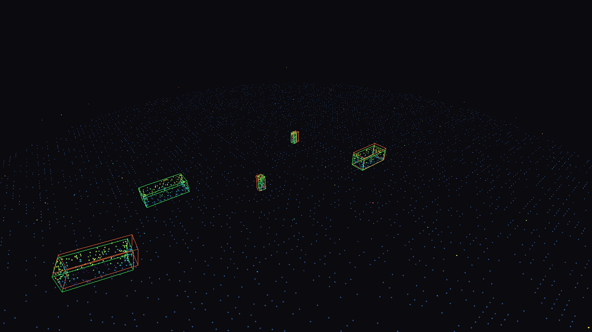

# PointScope

**An interactive, GPU-rendered debug visualizer for 3D point-cloud / LiDAR sensor sequences — with ground-truth vs. predicted bounding-box overlays and built-in detection metrics.**



*Green wireframes = ground truth, orange/red wireframes = a (simulated) detector's predictions, points colored by height. Screenshot rendered headlessly with `scripts/render_preview.py` — no window required.*

## Why this exists

A lot of my research so far (autonomous-vehicle LiDAR object detection at NC State, sensor/CNN work in Purdue's Snowball Lab) has involved staring at 3D point clouds and bounding-box annotations and wishing I had a faster way to *see* what a model got right or wrong, frame by frame, without writing a one-off matplotlib script every time. PointScope is that tool, built the way a tools/graphics engineer would: a real OpenGL render pipeline (vertex buffers, GLSL shaders, a camera matrix stack) wrapped in an interactive debug UI (frame scrubbing, overlay toggles, a live HUD), plus a small evaluation layer that tells you *how good* the overlaid predictions are, not just what they look like.

It ships with a seeded synthetic driving-scene generator so it runs out of the box with no proprietary dataset — but the data format it consumes (`frame_*.npy` point arrays + JSON box sidecars) mirrors common AV dataset conventions, so pointing it at a real capture is a short conversion script away.

## Features

- **Real-time GPU rendering** — points and 3D oriented bounding boxes drawn via custom GLSL shaders (`pointscope/shaders/`) through [moderngl](https://github.com/moderngl/moderngl), not a software/matplotlib fallback. Points are colored by height or intensity and size-attenuated by distance.
- **Ground-truth vs. prediction overlay** — toggle each on/off independently (`g` / `p`) to visually audit a detector's output.
- **Frame-by-frame playback and scrubbing** — play/pause, step one frame at a time, or let it loop at an adjustable FPS.
- **Orbit camera** — drag to orbit, right-drag to pan, scroll to zoom.
- **Live HUD** — frame index, point count, point size, and TP/FP/FN/mean-IoU for the current frame, shown right in the window title bar.
- **Detection metrics** (`pointscope/metrics.py`) — greedy IoU matching between predicted and ground-truth boxes, with KITTI-style bird's-eye-view-polygon-times-height-overlap 3D IoU (`pointscope/geometry.py`), aggregated into precision / recall / F1 / mean IoU over a whole sequence.
- **Headless render path** (`pointscope/offscreen.py`) — the exact same renderer runs with no window or display via an EGL standalone context, used for the automated tests and for generating the screenshot above.
- **CLI tools** — `scripts/evaluate.py` prints (and optionally CSVs) a per-frame + aggregate metrics report; `scripts/render_preview.py` grabs a PNG of any frame without opening the viewer.
- **Tested** — 35 automated tests (`pytest`) covering the camera math, polygon-clipping IoU (cross-checked against brute-force pixel rasterization), the synthetic data generator, the matching/metrics logic, and actual rendered pixel output — run automatically on push via GitHub Actions.

## Install

```bash
git clone https://github.com/<your-username>/pointscope.git
cd pointscope
python -m venv .venv && source .venv/bin/activate
pip install -r requirements.txt
```

Needs Python 3.9+ and a working OpenGL 3.3 driver (every modern laptop has one — you don't need a discrete GPU).

## Usage

Run the interactive viewer on the bundled synthetic demo sequence:

```bash
python -m pointscope.app
```

| Control | Action |
|---|---|
| Left-drag | Orbit camera |
| Right-drag | Pan camera target |
| Scroll | Zoom |
| `Space` | Play / pause |
| `←` / `→` | Step one frame back / forward |
| `g` | Toggle ground-truth boxes (green) |
| `p` | Toggle predicted boxes (orange) |
| `c` | Cycle point color mode (height ↔ intensity) |
| `=` / `-` | Point size up / down |
| `s` | Save a screenshot to `exports/` |
| `Esc` | Quit |

Point it at your own data instead:

```bash
python -m pointscope.app --data path/to/frame/dir --fps 15
```

Run the evaluation report from the command line:

```bash
python scripts/evaluate.py --num-frames 60 --iou-threshold 0.5
python scripts/evaluate.py --data path/to/frame/dir --csv report.csv
```

## Architecture

```
pointscope/
  geometry.py    camera matrices (look-at, perspective), OrbitCamera,
                 oriented-box corners, Sutherland-Hodgman polygon
                 clipping, BEV / 3D IoU
  data.py        Frame dataclass, seeded synthetic sequence generator,
                 frame_*.npy + .json loader/saver for real captures
  metrics.py     greedy IoU matching, per-frame + sequence-level
                 precision / recall / F1 / mean IoU
  renderer.py    owns GPU programs + buffers, issues draw calls
                 (shared by the windowed app and the headless path)
  offscreen.py   headless EGL context + render-to-array / render-to-PNG
  app.py         moderngl_window interactive viewer (camera control,
                 playback, overlay toggles, HUD, screenshots)
  shaders/       point.vert/.frag, line.vert/.frag (GLSL)
scripts/
  evaluate.py        CLI metrics report (+ optional CSV export)
  render_preview.py  headless single-frame PNG render
tests/           pytest suite, including GPU-rendered-pixel checks
  conftest.py        skips the GL-backed tests gracefully if no headless
                      GL context is available in the environment
.github/workflows/tests.yml   CI: installs a headless Mesa/EGL stack and
                               runs the full test suite on every push
```

### Design notes

- **Why a custom point/line shader pair instead of a scene-graph library?** The whole point was to actually touch the graphics pipeline — vertex layouts, uniform uploads, GLSL — rather than call a high-level `draw_points()` from a plotting library.
- **Why BEV-polygon IoU instead of full 3D polyhedron intersection?** It's the same simplification the KITTI 3D-detection benchmark uses (project to bird's-eye-view, intersect as 2D convex polygons via Sutherland-Hodgman, scale by vertical overlap) — accurate for the near-vertical boxes real LiDAR detectors produce, and far simpler to implement and test correctly than general 3D polyhedron clipping.
- **Why ship synthetic data?** My actual research datasets are either lab-proprietary or still being collected, and a visualization tool should be runnable by anyone who clones it. The synthetic generator models the same things a real scene has — a ground plane, moving actors with 3D boxes, a noisy "detector" that sometimes misses or hallucinates a box — so every feature in the tool (and every metric in `evaluate.py`) is exercised exactly the way it would be on real data.

## Relevant background

This project draws directly on my work as an undergraduate researcher building a LiDAR-based object-detection pipeline for autonomous vehicles (NC State's Trustworthy Computing for Autonomous Vehicles Lab) and CNN-based sensor-data classification (Purdue's Snowball Lab) — PointScope is the debugging tool I wished I'd had for both.

## License

MIT — see [LICENSE](LICENSE).
